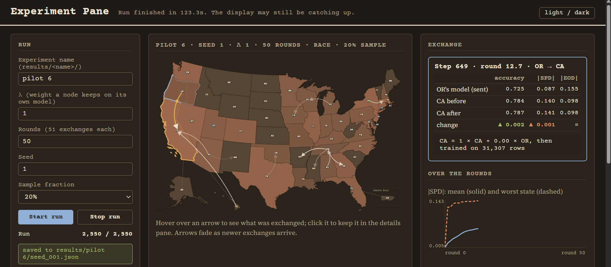
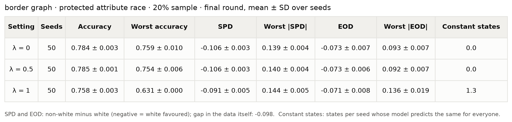
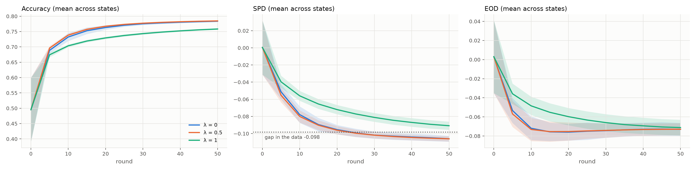
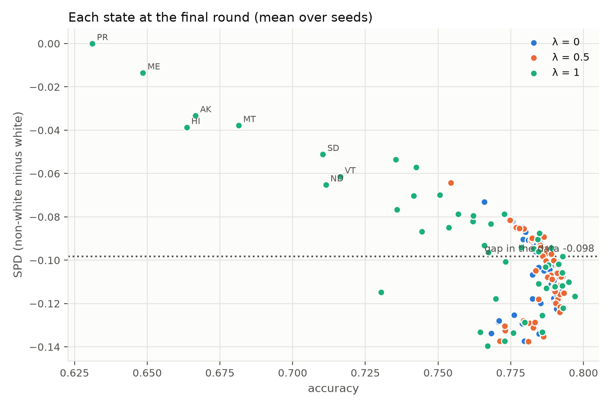
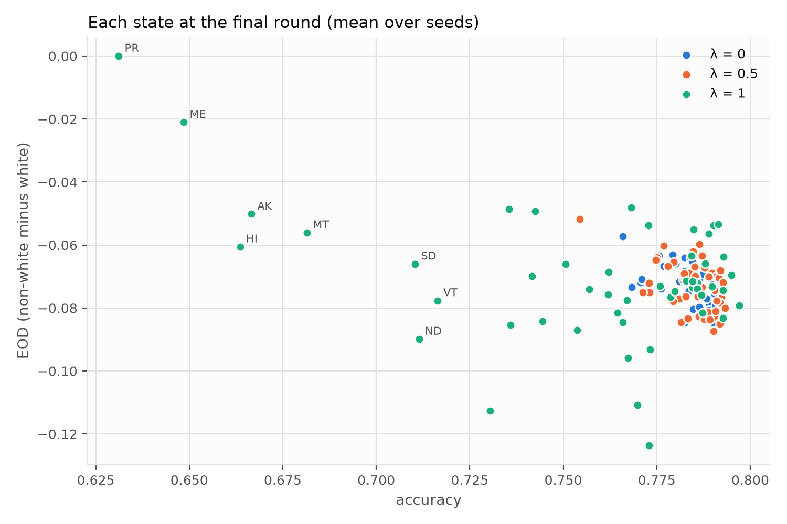
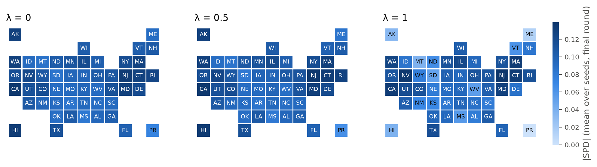

# Fairness in Gossip Learning

## Research question

**How fair is a model trained by asynchronous gossip learning across US states, and how do the merge weight λ and the communication graph affect group fairness by race (white / non-white)?**

- **Nodes:** 51, one per state (50 states plus Puerto Rico). Each holds only its own residents' ACSIncome records.
- **Links:** states that share a border. Alaska, Hawaii and Puerto Rico are linked to their nearest mainland state (WA, CA and FL).
- **Gossip:** at each step, a random state sends its model to a random neighbour. The receiver merges with `new = λ·mine + (1−λ)·received`, then trains one epoch.
- **Fairness:** SPD and EOD between white and non-white people, measured for every state's model on a shared test set.
- **In scope:** consensus gossip, where all nodes move towards one shared model. Personalised models are out of scope.

The full design is in [docs/experimental_design.md](docs/experimental_design.md). How the code fits together is in [docs/architecture.md](docs/architecture.md).



_The experiment pane during a run. Each arrow is one model exchange between neighbouring states, and states are coloured by unfairness (|SPD|). The right panel shows what the receiver's model looked like before and after merging, plus the mean and worst-state |SPD| over the rounds._

## Folder structure

```
experiment/
├── configs.json          every setting (the only file edited between experiments)
├── prepare_data.py       load ACSIncome, group codes, sample, split and encode per seed
├── model.py              the network (Fair2Zero's MLP), training, accuracy, SPD and EOD
├── learning.py           border graph and random-step gossip with the λ merge
├── run.py                runs all seeds in parallel and saves results
├── summarize.py          tables and figures per experiment group → results/summaries/
├── eda.ipynb             exploration of ACSIncome by state and group
├── experiment_pane/      live browser view of one run on a US map
│   ├── server.py
│   ├── index.html
│   └── vendor/           D3, topojson and US state outlines, saved for offline use
├── reference/            fixed inputs, checked by SHA-256
│   ├── PUMS_Data_Dictionary_2018.txt   for grouping occupation and birthplace
│   └── state_neighbors.csv             state border list
├── docs/
│   ├── experimental_design.md
│   └── architecture.md
├── archive/              earlier work: Fair2Zero reproduction on Adult (FL and gossip)
├── data/                 cached ACS data and per-seed splits (not tracked)
└── results/              one folder per experiment (not tracked)
    └── <experiment_name>/
        ├── config.json   the settings used
        └── seed_XXX.json per-state accuracy, SPD and EOD at each checkpoint
```

## Running

Use the project's virtual environment (`torch`, `numpy`, `pandas`, `folktables`).

```
python run.py                        # all seeds from configs.json, saved to results/<experiment_name>/
python summarize.py                  # tables and figures for every results/Experiment_<n>_... group
python experiment_pane/server.py     # live view at http://localhost:8000 (one seed)
```

- To start a new experiment, change `experiment_name` in `configs.json`.
- If a run stops, restart it: seeds that already have results are skipped.
- A folder that holds results from different settings is never reused.

## Results: Experiment 1 (border topology, push protocol)

**Setup:**
- Border graph, race (white / non-white), 20% sample.
- 50 rounds, evaluation every 5 rounds.
- **50 paired seeds per λ:** each seed uses the same sample, split, starting model and exchange sequence for every λ.
- **Push protocol** (as in Hegedűs et al., 2019): each step a random state sends its model to a random neighbour, and the receiver merges and trains.

Results are in `results/Experiment_1_lambda_{0,0.5,1}/`. The figures are made by `python summarize.py` and copied to `docs/images/experiment_1/`.

- **λ = 0:** the receiver adopts the sender's model, then trains.
- **λ = 0.5:** the receiver averages the two models, then trains.
- **λ = 1:** no gossip. The receiver ignores the received model, so each state learns alone, on the same training turns.

Values at round 50, mean over seeds. SPD and EOD are non-white minus white, so negative means white people are favoured.

|                                    | λ = 0  | λ = 0.5 | λ = 1 (alone) |
| ---------------------------------- | ------ | ------- | ------------- |
| Mean accuracy                      | 0.784  | 0.785   | 0.758         |
| Worst state's accuracy             | 0.759  | 0.754   | 0.631         |
| Accuracy spread across states (SD) | 0.008  | 0.008   | 0.041         |
| Mean SPD                           | −0.106 | −0.106  | −0.091        |
| Worst state's \|SPD\|              | 0.139  | 0.140   | 0.144         |
| SPD spread across states (SD)      | 0.017  | 0.018   | 0.033         |
| Mean EOD                           | −0.073 | −0.073  | −0.071        |
| Worst state's \|EOD\|              | 0.093  | 0.092   | 0.136         |

The paired 95% CIs are about ±0.001–0.005. Every gossip vs no-gossip difference has the same sign in at least 43 of 50 seeds.



**Reference points for SPD and EOD:**
- **The gap in the data (−0.098)** is the SPD of real incomes: 29.2% of non-white people earn more than $50K, against 39.1% of white people. A model with SPD near −0.098 is reproducing the inequality already in the data.
- **EOD has no data gap.** It compares the groups only among people who really earn more than $50K, so on real incomes it is always 0. Any EOD the models show is **added by the model**.



*Over the rounds: with gossip, SPD moves past the data's gap (−0.098) to −0.106 and is still drifting at round 50. EOD settles at about −0.075 by round 10 and stays there. Alone (λ = 1), states learn more slowly and SPD stays closer to 0.*



*One dot per state. The "fairer" states at λ = 1 (PR, ME, HI, AK, MT on the left) are the ones whose models barely learned. Among accurate states, gossip and learning alone have the same SPD.*



*Same mean EOD, but with gossip the states cluster tightly (−0.06 to −0.085), while alone they spread from −0.05 to −0.12. Gossip removes the extreme states.*



*|SPD| per state. With gossip, every state reaches a similar level. Alone, the small states (PR, ME, HI, AK) look fair only because they learned little.*

**Findings**

1. **Gossip makes every state accurate.**
   - Mean accuracy rises by 0.026, and worst-state accuracy by 0.128.
   - Small states gain the most: PR goes from 0.631 to 0.766, ME from 0.649 to 0.779, HI from 0.664 to 0.785, and AK from 0.667 to 0.781.
   - Large states lose slightly: NY goes from 0.790 to 0.782, and TX from 0.797 to 0.792.
2. **At equal accuracy, gossip has no fairness cost.**
   - In the about 27 states that learn well alone, accuracy is 0.787 with gossip vs 0.786 alone, and SPD is −0.110 vs −0.108.
   - The lower mean SPD at λ = 1 comes from under-trained small states. Learning alone, PR predicts "≤ $50K" for everyone in 50 of 50 seeds (ME in 8, HI in 5, AK in 1).
3. **Gossip makes states alike and improves the worst case.**
   - The spread across states halves for SPD and falls 5× for accuracy.
   - Worst |EOD| drops from 0.136 to 0.093.
   - Mean EOD is unchanged.
4. **λ between 0 and 0.5 makes no practical difference.**
   - All differences are ≤ 0.005.
   - The only consistent effects are small. λ = 0.5 learns slightly faster early on, and leaves states slightly less alike.
   - The effect comes from **gossiping or not**, not from how strongly states mix.
5. **The models learn the data's own gap.**
   - In the data, non-white people earn more than $50K less often (gap −0.098).
   - With gossip, mean SPD goes from −0.05 at round 5 to −0.106 at round 50 as accuracy rises.
   - The worst state's |SPD| stays at about 0.13–0.14 from round 5 onwards.

**Is λ = 1 fairer? No.** Its lower mean SPD (−0.091) comes from models that learned little or nothing (PR says "≤ $50K" to everyone). At equal accuracy, SPD is the same with and without gossip. On the worst state's |SPD|, the worst state's |EOD| and the spread across states, gossip is fairer.

**Why some states fail alone: the push protocol plus the topology**
- Under push, only the receiver trains, and a state receives only when a neighbour picks it. How much a state trains therefore depends on the graph: from 11.6 turns per run (HI) to 85 (MA).
- States with one neighbour (AK, HI, ME, PR) train least.
- PR's data adds to this: only 10.6% of its people earn more than $50K, so predicting "no" for everyone is close to optimal for PR's own data.
- With gossip on, the same states become accurate. **Gossip fixes what the protocol and topology break.**

**What these results can and cannot say**

- Without a reference point, they can't say whether gossip is fair **in absolute terms**. A centralised model and FedAvg are needed for that.
- λ = 1 here is not a true local-only baseline, because training turns are unequal (above).
- Results are still drifting slightly at round 50.

## Next: Experiment 2 (topologies, pull protocol)

Comparing topologies under push would compare training budgets, not graph shapes. In a star, the hub would train about 2,500 times per run and each other state about once. Experiment 2 therefore uses **pull**:

- each step, a random **receiver** fetches the model of a random neighbour, merges it with λ and trains;
- **every state trains about 50 times in 50 rounds, on any graph.**

Push and pull are the classic gossip variants (Demers et al., 1987; asynchronous model: Boyd et al., 2006). Experiment 1 keeps push, as the original gossip learning protocol.

| Run | Topology | λ |
|---|---|---|
| `Experiment_2_border_lambda_{0,0.5}` | border (re-run under pull) | 0, 0.5 |
| `Experiment_2_star_lambda_{0,0.5}` | star: one hub state linked to all others | 0, 0.5 |
| `Experiment_2_alone` | any (under pull, λ = 1 does not depend on the graph) | 1 |
| FedAvg | central server, weighted average | — |

To decide: the hub (VA, near the capital, or CA, the largest) and the number of seeds (20 first, extended to 50 later).

**Code verification:** three independent reviews of the data pipeline, model, gossip loop and runner found no bug that affects results. Checks included rebuilding states from the raw Census files, independent numpy metrics, the graph, pairing across λ, and reproducibility.

### Pilots (seed 1)

Pilots 4–6 (λ 0.25, 0.5 and 1) and pilot 2 (100 rounds) were used to check the pipeline and choose 50 rounds. Pilot 6 is identical to λ = 1 seed 1, which confirms runs are reproducible.

## Changes to be made

**Next runs**

- [ ] Experiment 1 (border): λ = 0, 0.5 and 1, with 50 seeds each.
- [ ] λ = 0.75, 0.9 and 0.99, to find where the drop between λ = 0.5 and λ = 1 happens.
- [ ] Centralised baseline (all data pooled, same seeds and test sets): the reference for accuracy and fairness.
- [ ] Experiment 2: the pull protocol, the star graph, and the runs listed above.
- [ ] Later topologies: random (same number of links per state), clustered (Census regions).
- [ ] Robustness checks: sex as the protected attribute, excluding PR, a 40% sample.

**Experiment pane**

- [ ] Fix the bugs in `experiment_pane/` (several known issues; to be listed and fixed one by one).

**Federated learning baseline**

- [ ] Write FedAvg in `learning.py`, using the same seeds, samples, splits, model and evaluation as gossip.
- [ ] Run the FedAvg baseline and compare it with gossip (`baselines` settings in `configs.json`).

**Code**

- [x] `summarize.py` produces, per experiment group:
  - a table (mean ± SD over seeds, with constant predictors flagged);
  - accuracy, SPD and EOD over the rounds;
  - accuracy vs SPD and accuracy vs EOD per state;
  - a per-state map.
- [ ] Record each state's number of training turns. Under random steps they range from about 12 (HI) to 85 (MA) per run.
- [ ] Evaluate the average of all node models (the consensus model), not only each node's model.
- [ ] Save the code version (git commit) with each result.
- [ ] Warn when `rounds` is not a multiple of `eval_checkpoint_every`, since the final checkpoint is then skipped.
- [x] Folder check ignores `seeds` and `compute`, so seeds can be added later.
- [x] Split files and results are saved atomically; λ outside 0–1 is refused.
- [ ] Add a `.gitattributes` binary rule for `reference/`, so line-ending changes cannot break the SHA-256 checks.
- [ ] Later: the random graph (Experiment 2), the local-only baseline, and the results map.

**Docs**

- [ ] `experimental_design.md`: still describes time in steps, a 10% pilot and evaluation every 255 steps. Update to rounds, the 20% pilot, `eval_checkpoint_every` and the λ = 1 finding.
- [ ] Close the resolved open decisions (grouping, standardisation, run time) and record the choices made.
- [ ] `architecture.md`: the experiment pane now exists; the "Open" questions about code location and the border list are settled.

**Parked**

- Synchronous reference (Experiment 3, not gossip learning) and the message-queue variant.
